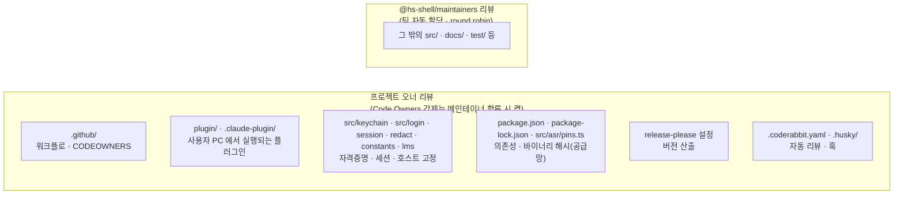
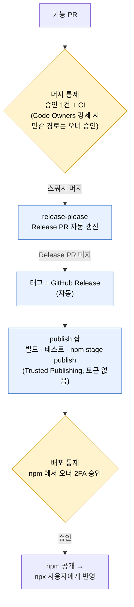

# 메인테이너 가이드

메인테이너 권한·배포 승인·운영 절차를 정리한다. 기여 절차는 [CONTRIBUTING.md](./CONTRIBUTING.md) 참고.

## 역할과 권한

| 역할          | GitHub 권한  | 할 수 있는 일                               |
| ------------- | ------------ | ------------------------------------------- |
| 프로젝트 오너 | **Admin**    | 저장소·브랜치 보호 설정, npm 배포 승인(2FA) |
| 메인테이너    | **Maintain** | PR 리뷰·머지, 이슈 관리, 릴리즈 PR 머지     |
| 기여자        | 없음 (Fork)  | PR 제출                                     |

- **Admin 은 오너 외에 부여하지 않는다.** Admin 은 브랜치 보호 규칙을 직접 바꿀 수 있어 어떤 통제로도 막을 수 없다.
- 메인테이너는 **Maintain** 까지. Maintain 은 보호 규칙·Variables 를 바꿀 수 없다.
- 오너·메인테이너 모두 GitHub 2단계 인증(가능하면 패스키) 필수.

## 코드 오너십

리뷰어 지정 규칙은 [`.github/CODEOWNERS`](./.github/CODEOWNERS) 에 있다. 배포·권한·공급망·자격증명에 영향을 주는 경로는 메인테이너가 늘어나도 **프로젝트 오너 리뷰**를 유지한다.

## 배포 구조와 통제 지점

- npm 배포용 장기 토큰은 저장소에 없다. `release-please.yml` 의 `publish` 잡이 OIDC 로 Trusted Publishing 하며, 스테이징으로만 올라가 오너가 2FA 로 승인해야 공개된다.

## 릴리즈 / 버전 규칙

릴리즈는 **release-please** 로 관리한다 (통합과 배포 분리).

- 평소 PR 을 main 에 머지해도 릴리즈는 나가지 않는다. release-please 가 Conventional Commits 를 읽어 **Release PR**(버전 범프 + CHANGELOG)을 자동으로 만들고 갱신한다.
- 발행하려면 **Release PR 을 머지**한다 → 태그 + GitHub Release + npm 스테이징 배포.
- 버전은 커밋 타입에서 자동 산출된다 (`feat` → minor, `fix` → patch, `feat!`/`BREAKING CHANGE` → major). `build`/`ci`/`docs`/`chore` 는 버전을 올리지 않는다.

## 메인테이너 합류 시 체크리스트 (오너)

혼자 운영할 때는 승인해 줄 사람이 없어 꺼 둔 설정들을, 메인테이너가 생기면 켠다.

1. 새 메인테이너를 `hs-shell/maintainers` 팀에 추가하고, 팀에 이 저장소 **Maintain** 권한을 연결, 조직 2FA 필수화
2. 팀 설정 → **Code review** → 자동 할당이 켜져 있는지 확인 (리뷰어 1명, **Round robin**, 팀 전체 알림 끄기). CODEOWNERS 의 `*` 가 팀을 가리키므로 PR 이 열리면 팀원 1명이 순번대로 배정된다.
3. 브랜치 보호(`main`)
   - **Require review from Code Owners** 켜기 → 민감 경로는 오너 승인 필수
   - **Require approval of the most recent reviewable push** 켜기 → 승인 후 몰래 커밋 추가 차단
   - **Do not allow bypassing the above settings**(관리자 포함 적용) 켜기 → 이제 서로 승인 가능하므로 `--admin` 머지 불필요

## 일상 운영

- **머지**: 스쿼시 머지만 사용. PR 제목이 Conventional Commits 여야 release-please 가 버전을 산출한다.
- **Dependabot**: 주 1회 그룹 PR(npm minor/patch, actions minor/patch), major 는 개별 PR. CI 통과를 확인하고 머지하되, major 는 변경 로그를 확인한다.
- **리뷰 배정**: PR 이 열리면 CODEOWNERS 에 따라 `@hs-shell/maintainers` 팀에 요청되고, 팀 자동 할당이 팀원 1명을 순번(round robin)으로 배정한다. 상태를 "Busy" 로 두면 배정에서 빠진다. 민감 경로 파일은 오너에게 요청된다 (그 외 파일도 함께 바뀌면 팀에도 요청).
- **CodeRabbit**: 무료 한도가 시간당 1회라 여러 PR 을 동시에 올리면 리뷰가 밀린다. 필요하면 `@coderabbitai review` 로 재요청.

## 비상 대응 (배포 경로 침해 의심 시)

1. npm 에서 스테이징된 버전을 승인하지 않고 폐기, 패키지 설정에서 Trusted Publisher 연결 해제
2. 이미 공개된 문제 버전은 `npm deprecate` 로 표시하고 수정 버전을 배포
3. 의심 계정의 저장소 권한 회수 후 원인 조사
